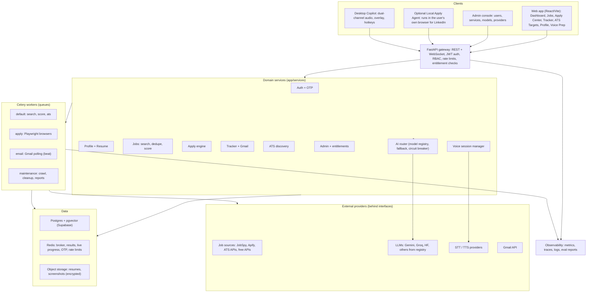
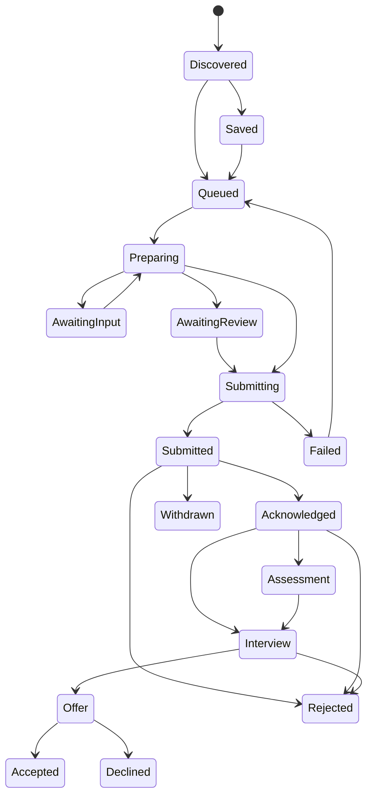
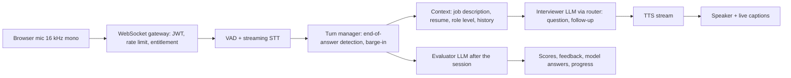
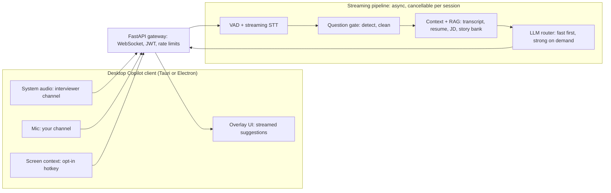
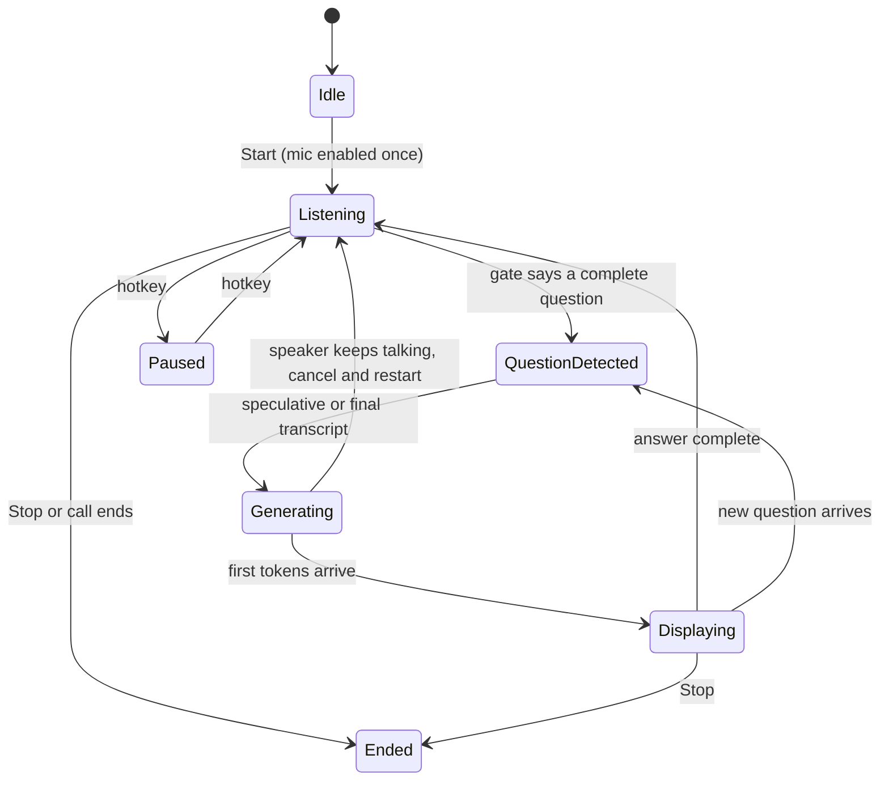

# Job Finder AI — Project Blueprint

> **Read this first.** This file is the single source of truth for what this product is, why it exists, and how it must be built. Any AI coding agent or developer who receives this repository must read this file fully before changing code. If code and this document disagree, raise it and fix one of them — do not silently drift.
>
> This file is the repo's `CLAUDE.md`, so coding agents load it automatically. Keep a copy (or `AGENTS.md`) in the frontend repo too.

---

## 0. How to use this document (instructions for AI agents)

1. **Read sections 1–6 completely** before writing any code. They define the goal, the architecture and what already exists.
2. **Build in the order of Section 15 (Roadmap).** Do not start a later phase before the acceptance criteria of the earlier one pass.
3. **Extend, don't rewrite.** Section 6 lists the existing modules. Reuse them (`record_status`, `pipeline_progress`, `scorer`, `browser_apply`, `email_tracker`, `limiter`, `get_current_user`). Refactor only when a section here says so.
4. **One responsibility per layer:** routes are thin (validate → authorize → dispatch/call service); business logic lives in `app/services/`; I/O adapters (job boards, LLMs, STT/TTS, Gmail) live behind interfaces in `app/providers/`.
5. **Every feature is gated by an entitlement** (Section 7.11) and **every external provider/model is selected through a registry** (Sections 7.4, 7.9). Never hardcode a provider, model name or API key in business logic.
6. **Safety defaults:** auto-submit is OFF unless the user turned it on; no secret ever goes into logs, Celery args, or API responses; every table row is scoped by `user_id`.
7. **Each change ships with:** an Alembic migration (if schema changed), tests, updated OpenAPI docs, and an update to this file if behaviour changed.
8. When something here is marked **`[ASSUMPTION]`**, confirm with the product owner before building it.

---

## 1. Vision and principles

**Mission:** one AI-powered workspace that takes a job seeker from *"what roles fit me?"* to *"I'm prepared and applied"* — finding jobs, ranking them against the real resume, applying (automatically or manually from the same screen), tracking every application including replies in Gmail, and practising interviews by voice.

**Principles**

| # | Principle | Meaning in practice |
|---|-----------|---------------------|
| 1 | **Human stays in control** | Autopilot has three levels (assist → review-and-submit → full auto). Default is the safest. Every automated action is logged and reversible where possible. |
| 2 | **Unique jobs only** | The same job on LinkedIn and Indeed is shown once. When both exist, **keep the LinkedIn copy** (it supports Easy Apply). |
| 3 | **Truthful AI** | AI never invents experience, skills or answers. Form answers and resume tailoring are grounded in the user's profile; unknown required fields pause for the user. |
| 4 | **Free-first, paid-optional** | Every capability has a free path (free job sources, free LLM tiers). Paid providers/models are opt-in. |
| 5 | **Everything is configurable by admin** | Users, roles, per-user services, AI models and job providers are managed in an admin console, not in code. |
| 6 | **Observable and measurable** | Every pipeline stage emits metrics; AI quality is measured with eval sets. |
| 7 | **Privacy by design** | Minimal Gmail scope, encrypted secrets and tokens, retention limits, one-click delete. |

---

## 2. Users and roles

| Role | Can do |
|------|--------|
| **Job seeker (user)** | Everything in Sections 7.1–7.10 for features enabled on their account. |
| **Manager** | See and manage users assigned to their team: enable/disable accounts, toggle services within limits set by admin, view usage. Cannot change global providers, models or other managers. |
| **Admin** | Everything: users, managers, roles, per-user entitlements, provider catalog, AI model registry, global feature flags, audit log, system health. |

Roles are enforced by RBAC dependencies (`require_role("admin")`, `require_role("manager", "admin")`) on every admin route, never only in the UI.

---

## 3. Feature map

| # | Module | Summary | Phase |
|---|--------|---------|-------|
| 1 | **Identity** | Google sign-in + email OTP validation, JWT sessions, account status | P1 |
| 2 | **Admin console** | Users, managers, per-user services, enable/disable, audit | P1 |
| 3 | **AI model registry** | Admin adds free/paid models; users opt in per task | P2 |
| 4 | **Provider catalog** | Job sources with free/paid flags; "free tools only" mode | P2 |
| 5 | **Profile + resume** | Upload/update resume, parsed profile, versions, job preferences | P3 |
| 6 | **Search profile** | One combined *Keywords & Skills* section | P3 |
| 7 | **Job pipeline** | Search → dedupe → score → stream live results | exists + P3 |
| 8 | **Apply Center** | Auto-apply and manual apply from one interface | P4 |
| 9 | **Application tracker** | Status timeline per application + Gmail reply detection + AI rejection note | P5 |
| 10 | **ATS Target Discovery** | Enter a job title → list companies hiring on Workday, Greenhouse, Lever, Recruitee | P6 |
| 11 | **Voice interview prep** | Mock interviewer (practice) + **Live Copilot** (real-time answer suggestions on an overlay, like Parakeet AI / Cluely), scoring and feedback | P7 |
| 12 | **Platform** | Observability, evals, CI, deployment, scale | P8 |

---

## 4. System architecture



**Design rules**

- The **gateway never does slow work.** Anything longer than ~1 s becomes a Celery task; the client polls (`/tasks/{id}`, `/pipeline/{run_id}/jobs`) or listens on a WebSocket/SSE.
- **Providers are plug-ins.** Job sources, LLMs, STT and TTS are each an interface with several implementations chosen from the registry (Sections 7.4, 7.9).
- **Redis** holds ephemeral state (broker, task results, live run progress, OTP codes, rate-limit counters). **Postgres** holds everything durable.
- **Per-user isolation:** every query filters by `user_id`; every Celery job carries `user_id`; browser profiles are per user on the worker.

---

## 5. Technology stack

| Layer | Choice |
|-------|--------|
| API | Python 3.11+, FastAPI, Pydantic v2, SlowAPI rate limiting |
| Async work | Celery + Redis (Upstash, TLS `rediss://`), Celery beat for schedules |
| Database | Postgres (Supabase, pooler port 6543 transaction mode), SQLAlchemy, **Alembic migrations**, pgvector |
| Browser automation | Playwright (Chromium) on the `apply` queue |
| Scraping | `python-jobspy`, Apify actors (optional), official/public ATS endpoints |
| LLMs | Via AI router: Gemini, Groq, Hugging Face by default; more through registry |
| Voice | Streaming STT + TTS behind interfaces; WebSocket transport |
| Desktop client | Tauri (preferred) or Electron for Live Copilot: system-audio capture, overlay, global hotkeys |
| Email | Gmail API (OAuth), transactional email provider for OTP |
| Frontend | React + Vite (repo `Job-Finder-AI-Frontend`) — keep its framework; TypeScript preferred |
| Deploy | Oracle Cloud VM under systemd (`job_finder_api`, `job_finder_celery.service`) + Docker option |
| Observability | Structured JSON logs, Prometheus-style metrics, OpenTelemetry traces |

---

## 6. Current codebase status

### 6.1 What already exists

This file lives at the root of the **backend repo** ([Job-Finder-AI-Backend](https://github.com/vishavanish/Job-Finder-AI-Backend)); paths below are relative to it. The frontend is a separate repo ([Job-Finder-AI-Frontend](https://github.com/vishavanish/Job-Finder-AI-Frontend)). On the owner's machine both sit under a parent folder that also holds the **legacy v1 CLI** (`main.py`, `job_sources.py`, `scorer.py`, ... — not in any repo); it is superseded by `app/services/`, do not extend it.

| Area | File(s) | Notes |
|------|---------|-------|
| Router wiring | `app/api/routes/__init__.py` | search, company_ats, score, apply, pipeline, tasks, auth, applications. Mounted under `/api/v1` already (`settings.API_V1_PREFIX`). |
| Config | `app/core/config.py` | `pydantic-settings`, reads `.env` at the repo root. Queue names get a `_dev` suffix unless `ENVIRONMENT=production`. |
| Database | `app/core/db.py`, `app/models/` | One SQLAlchemy engine on **Supabase Postgres** (`DATABASE_URL`). Tables: `users`, `applications`, `application_status_events`, `pipeline_runs`, `pipeline_run_jobs` (the last two are unused — streaming state lives in Redis), plus P1–P3 tables (admin, AI, profile/resumes/preferences/search profiles, `jobs`/`job_sources_seen`/`user_jobs`). |
| Search | `routes/search.py`, `services/job_sources.py`, `providers/job_sources/` (registry, feeds, aggregators), `services/source_limits.py`, `services/naukri_apify_source.py` | JobSpy (LinkedIn, Indeed, Glassdoor, Google Jobs), keyed APIs (Adzuna, Jooble, Careerjet), cached remote feeds (RemoteOK, Remotive, Himalayas, Jobicy, Arbeitnow, The Muse, We Work Remotely), Naukri via manual list or Apify; retries and pacing (P3.1, Section 6.7) |
| Dedupe | `services/job_dedupe.py`, `services/source_info.py`, `job_sources._deduplicate_jobs`, `pipeline_progress.claim_job_key` | Key = normalized company + title + city. **LinkedIn copy wins**, then company ATS > job board > aggregator/feed (P3.1); longer description within a rank. (Added in Phase 0 — before that, dedupe was by exact URL, so cross-source duplicates were never merged.) |
| Scoring | `routes/score.py`, `services/scorer.py`, `core/celery_tasks._score_one_job_llm` | Keyword prefilter → LLM score via the **AI router** (P2). Batched path `scorer.score_jobs`, per-job path `scorer.score_one_job`. A reply that can't be parsed counts as a failed call. |
| AI models & router | `services/ai_router.py`, `services/model_registry.py`, `providers/llm/`, `routes/models.py`, `routes/admin_ai.py` | Registry rows in `ai_models`; adapters: `gemini`, `groq`, `huggingface`, `anthropic` (official SDK), `openai_compatible` (any `/chat/completions` base URL). Chain: user choice → admin default → priority; Redis circuit breaker; every attempt in `usage_ledger`. |
| Keys | `services/key_store.py`, `models/ai.Secret` | Envelope-encrypted platform + BYOK keys, masked (`last4`) everywhere. Lookup: user key → platform key → `.env` key. Request-body keys still work as one-run keys (`secret_refs`). |
| Job-source catalog | `services/provider_catalog.py`, `routes/providers.py` | `provider_catalog` rows for every source in `providers/job_sources/registry.py` (Section 7.4). Routes drop sources that are off (admin/user/`default_enabled`), paid under Free tools only, missing a key, paused after repeated errors, or remote-only feeds on a non-remote search; `skipped_sources` says why. |
| Streaming pipeline | `routes/pipeline.py`, `services/pipeline_progress.py` | Fan-out per keyword (plain Celery `group`, **not** `chord` — chords are unreliable on Upstash), results in a Redis list, polled by offset |
| Company ATS | `routes/company_ats.py`, `services/company_ats_sources.py` | Greenhouse, Lever, SmartRecruiters, Workday, Oracle Fusion, SuccessFactors, Ashby, Recruitee, Workable, Personio, Breezy (P3.1), custom (JSON probe → Playwright DOM fallback). SSRF guard `_reject_private_targets` (custom + workday URLs); subdomain slugs limited to DNS-label characters. |
| Apply | `routes/apply.py`, `services/browser_apply.py` | Playwright, LinkedIn Easy Apply prefill (`_FILL_DISPATCH`, `AUTO_APPLY_CAPABLE_SOURCES = {"LinkedIn"}`), never auto-submits, capability filter; client-supplied `browser_profile_dir` is ignored (`task_params.build_apply_params`). The frontend calls `POST /apply/{id}/close`, which the backend does **not** implement. |
| Tracking | `routes/applications.py`, `services/applications_store.py` | `record_status()` single write path (upsert + history event) |
| Gmail | `services/email_tracker.py`, `scripts/gmail_authorize.py` | Multi-account polling via `token_<label>.json` files, keyword prefilter. Classifier, matching and status update are **not built**; no Celery beat schedule exists yet. |
| Auth | `routes/auth.py`, `core/auth.py`, `services/sessions.py`, `services/otp.py`, `services/accounts.py`, `providers/google_identity.py`, `providers/email.py` | Email OTP, Google ID-token sign-in, legacy password login. 15-min access JWT + rotating httpOnly refresh cookie (reuse ⇒ all sessions revoked). Revocation = bump `users.session_version` (stamped into every token). Disabled accounts get `403 {code: "account_disabled"}` on every path. `GET /auth/me` includes per-feature entitlements with `quota_remaining`. |
| RBAC & admin | `core/auth.require_role`, `routes/admin.py`, `services/user_admin.py` | Roles user/manager/admin. Admin: users CRUD, roles, teams, flags, audit. Managers: only their team (list, enable/disable, reset sessions, entitlements within their own limits). Disabling revokes sessions and cancels the user's tasks and streaming runs. |
| Entitlements & flags | `services/entitlements.py`, `services/feature_flags.py`, `models/admin.py` | `require_feature("x")` on every feature route (403 off / 429 over daily quota / 503 kill switch). Flags: `invite_only`, `auto_apply_enabled`. |
| Audit | `services/audit.py`, `models/admin.AuditLog` | Append-only; written in the same transaction as the change. `GET /admin/audit`. |
| Tasks | `routes/tasks.py`, `core/task_dispatch.py` | Every route dispatches through `task_dispatch.dispatch()`, which records `task_id → user_id` in Redis; `GET /tasks/{id}` and `cancel` 404 for anyone but the owner. |
| Task params & secrets | `services/task_params.py`, `services/secret_refs.py` | One builder per request type; user API keys become encrypted `*_key_ref`s resolved in the worker. |
| Shared Redis | `core/redis_client.py` | One client per process (`get_redis()`); tests swap in fakeredis. |
| Frontend | separate repo `Job-Finder-AI-Frontend` | React 18 + Vite + react-router, plain JS (no TypeScript), axios client with hardcoded `API_URL`. Pages: Home, Keywords, Skills, ATS Targets, Providers, Applications, Profile, Login. Deployed on Vercel. |

**Migrations & tests:** Alembic in `migrations/` (`0001` idempotent baseline, `0002` `applications.job_key` + `alias_urls`, `0003` identity & admin tables, `0004` models & providers, `0005` profile & search, `0006` free job sources, `0007` insights & alerts); startup no longer calls `create_all`. Tests in `tests/` (pytest, SQLite built by the migrations, fakeredis, Celery publishing stubbed).

**CI:** `.github/workflows/tests.yml` runs the tests on every push and pull request (no secrets needed).

**Not present yet:** Docker.

### 6.2 Known issues to fix in Phase 0 (found by reviewing the code)

| # | Issue | Fix |
|---|-------|-----|
| 1 | `GET /tasks/{task_id}` has **no auth and no ownership check**; any caller with a task id can read results, and `cancel` only checks login, not ownership. | Store `task_id → user_id` in Redis (with TTL) at dispatch; verify on read/cancel; 404 otherwise. |
| 2 | User-supplied **API keys (Gemini, Groq, HF, Apify) travel in request bodies and Celery args**, so they sit in Redis broker/result storage in plain text. | Interim (P0): encrypt into Redis under a short-lived `key_ref`; tasks receive only the ref. Full encrypted key store comes in P2 (Section 7.9). |
| 3 | `ScoreRequest` accepts `groq_model` / `groq_api_key`, but `score.py` / `pipeline.py` never forward them (and `ScoreRequestPartial` lacks them), so only the server's `GROQ_API_KEY` and the default Groq model are ever used. | Forward them now; replace with the AI router in P2. |
| 4 | **Open self-registration** (the disabled-registration block is commented out) with no email proof. | P0: `ALLOW_SELF_REGISTRATION` switch. P1: OTP-verified signup (Section 7.1) + admin invite-only flag. |
| 5 | `record_status` upserts by **URL only**, so the same job from two sources creates two application rows. | Also look up by `(user_id, job_key)`; if found from another source, attach the new URL as an alias. |
| 6 | `email_tracker` sets `received_at` to *now* instead of the message's real date, and keeps Gmail tokens in **files named by label**. | Use Gmail `internalDate`; move per-user tokens encrypted into DB in P5 (Section 7.8). |
| 7 | Streaming pipeline scores duplicates **before** they are deduped, wasting LLM calls. | In the per-keyword task, claim each `job_key` for the run in Redis *before* the LLM call; skip already-claimed keys. |
| 8 | `GET /tasks/{id}` reports `PENDING` for unknown ids. | Ownership record from issue 1 lets the API return 404 for ids the user never created. |
| 9 | **Real API keys were in the legacy CLI's `.env.example`** (parent folder, not in this repo): Apify, Upstash Redis, HF, Gemini, ScrapingBee. The legacy `t2v.py` also has the HF key. | Replace with placeholders; **the owner must rotate every one of those keys.** |
| 10 | `groq` is imported at module top by `scorer.py` but missing from `requirements.txt` — a fresh install crashes. | Add it (plus `alembic`). |
| 11 | `POST /pipeline/run` with an `apply` block calls `browser_apply.open_and_prepare` **without `user_id`** → `TypeError` at step 3. | Pass `user_id`. |
| 12 | `/health` reports queue length of a queue named `celery`, which nothing uses. | Report `settings.default_queue` / `apply_queue`. |

**Stuck-`pending` bug — confirmed cause:** `start.sh` starts the worker with `-Q default` only. (a) Nothing ever consumes the `apply` queue, so every `/apply` task stays `pending` forever. (b) Unless `ENVIRONMENT=production`, the API publishes to `default_dev` / `apply_dev`, which that worker does not listen to either. Fix: derive the worker's `-Q` list from `settings` (`default_queue,apply_queue`) and make `task_default_queue` follow settings. Also note the local `.env` sets `REDIS_URL` twice (local then Upstash; the last one wins) — keep exactly one so the API and worker cannot drift.

### 6.3 Phase 0 status

| Item | State |
|------|-------|
| 6.2 #1, #8 task ownership / 404 for unknown ids | ✅ done (`task_dispatch`, `routes/tasks.py`) |
| 6.2 #2 secrets out of Celery args | ✅ interim done (`secret_refs`, Redis + Fernet, TTL = `TASK_RESULT_TTL_SECONDS`). Durable store + BYOK UI is P2. |
| 6.2 #3 Groq forwarded | ✅ done (`groq_model` / `groq_api_key` on both score request models) |
| 6.2 #4 signup | ✅ P1: OTP-verified signup + admin `invite_only` flag (default = inverse of `ALLOW_SELF_REGISTRATION`). |
| 6.2 #5 `record_status` by `job_key` | ✅ done (+ migration `0002`) |
| 6.2 #6 email date | ✅ `internalDate` used. Token files → encrypted DB is P5. |
| 6.2 #7 dedupe before scoring | ✅ done (`pipeline_progress.claim_job_key`). The first-claimer limitation is gone since P3: the canonical `jobs` row holds the best copy and a later LinkedIn copy replaces the shown one (Section 6.6). |
| 6.2 #9 leaked keys | ⚠️ legacy `.env.example` now has placeholders; **owner must rotate the keys**. |
| 6.2 #10, #11, #12 | ✅ done |
| Stuck `pending` | ✅ fixed in code (`worker_queues`, `task_default_queue`, `start.sh`); confirm on the deployed worker. |
| Alembic baseline + tests | ✅ done (31 tests) |
| CI green | ✅ passed on GitHub Actions for `phase-0-hardening` |

**Operational changes introduced in P0**
- New env: `SECRETS_MASTER_KEY` (Fernet key) — **required when `ENVIRONMENT=production`** (startup refuses without it). `ALLOW_SELF_REGISTRATION` (bool).
- Run `alembic upgrade head` (from the repo root) before starting the API on every deploy. `start.sh` does this; systemd units must too.
- Worker must be started with `-Q "$(python -c 'from app.core.config import get_settings; print(get_settings().worker_queues)')"` (what `start.sh` does).
- Run tests: `pip install -r requirements-dev.txt && python -m pytest`.

### 6.4 Phase 1 status (branch `phase-1-identity`)

| Item | State |
|------|-------|
| Email OTP (7.1 rules) | ✅ Errors carry `code` for the UI: `otp_invalid` (+`attempts_left`), `otp_locked`, `otp_expired`, `otp_cooldown` (+`retry_after`), `otp_too_many_requests`. CSPRNG 6 digits, HMAC-only in Redis (keys hash the email), 10-min TTL, single use, 5 attempts, 60 s cooldown, hourly cap per email + per-IP rate limit, identical response for unknown/uninvited emails |
| Google sign-in | ✅ ID token verified by `google-auth` (signature, `iss`, `exp`, `aud` ∈ `GOOGLE_CLIENT_IDS`) + `email_verified`; links to an existing account by email |
| Sessions | ✅ 15-min access + rotating refresh cookie, reuse detection, logout, `session_version` revocation |
| RBAC, entitlements, quotas, kill switch | ✅ |
| Admin: users, managers/teams, entitlements, flags, audit log | ✅ API. Frontend F1 has UI for users (list, add, role, enable/disable, sign out everywhere), per-user entitlements and feature defaults; teams, flags and audit log have no UI yet |
| Disabled user locked out immediately | ✅ next request gets 403 `account_disabled`; refresh refused; tasks revoked; streaming runs cancelled |
| Every admin action audited | ✅ (`user.create/update/enable/disable/revoke_sessions`, `entitlement.set/reset`, `flag.set`, `user.signup`, `auth.login`, `auth.password_set`, `auth.refresh_token_reuse`, `user.role_set_cli`) |
| Tests | ✅ 77 total |
| Not in P1 | Usage view per user (needs the P2 usage ledger), "delete data" (data-rights work), bulk plans/templates, maintenance-mode flag |

**Operational changes introduced in P1**
- Migration `0003` (run `alembic upgrade head`).
- **Access tokens now last 15 minutes.** The frontend must call `POST /auth/refresh` (with `credentials: "include"`) on 401 and keep the access token in memory. Until it does, set `ACCESS_TOKEN_EXPIRE_MINUTES=10080` to keep the old 7-day behaviour.
- Refresh cookie is `SameSite=None; Secure` (frontend and API are cross-site); CORS already allows credentials for the Vercel origin.
- New env: `GOOGLE_CLIENT_IDS`, `EMAIL_BACKEND` (`console` dev only — OTP returns 503 in production with it), `SMTP_HOST/PORT/USERNAME/PASSWORD/FROM/STARTTLS`, OTP tuning (`OTP_*`), `RATE_LIMIT_AUTH`, `REFRESH_*`.
- First admin: `python -m app.scripts.set_role you@example.com admin` (audited; creates the account if needed).

### 6.5 Phase 2 status (branch `dev`)

| Item | State |
|------|-------|
| AI model registry | ✅ `ai_models` + admin CRUD (`/admin/models`), test button, per-task defaults. Admin adds any model, free or paid, without code; enabled models appear in users' `GET /models` at once. Seeded: Gemini 2.5 Flash → GPT-OSS 120B (Groq) → Qwen3 8B (HF), all free. |
| Providers | ✅ `gemini`, `groq`, `huggingface`, `anthropic`, `openai_compatible` (covers OpenAI, OpenRouter, Together, DeepSeek, Mistral, local Ollama). |
| Router | ✅ user choice → admin default → priority; skips disabled, wrong task, paid-not-allowed, Free-tools-only, keyless and breaker-open models (`AI_BREAKER_FAILURES` / `AI_BREAKER_COOLDOWN_SECONDS`). |
| Paid models | ✅ usable with the `premium_models` entitlement (platform key) **or** the user's own key for that scope; never under Free tools only (owner decision 2026-10-15). |
| BYOK + platform keys | ✅ `POST/GET/DELETE /keys`, `/admin/keys`; envelope encryption with `SECRETS_MASTER_KEY`; values never returned, logged, audited or enqueued. |
| Usage ledger | ✅ every attempt (tokens, latency, cost, key source); `GET /usage`, `GET /admin/usage`, `GET /admin/users/{id}/usage`. |
| Provider catalog + Free tools only | ✅ `GET /providers`, `PUT /providers/settings`, `/admin/providers`. Free tools only skips paid sources **and** paid models. |
| Tests | ✅ 101 total (20 for P2) |
| Not in P2 | STT/TTS/embeddings providers (P7); new job sources (RemoteOK, Adzuna… — moved to a follow-up after P3); source auto-disable on repeated failures (only success/last error recorded); all screens (frontend F2). |

**Operational changes introduced in P2**
- Migration `0004` (run `alembic upgrade head`). Seeds the three current models and four job sources.
- `.env` keys (`GEMINI_API_KEY`, `GROQ_API_KEY`, `HF_API_KEY`, `APIFY_API_TOKEN`, new `ANTHROPIC_API_KEY`) keep working as the last fallback; keys stored by an admin under `/admin/keys` take priority.
- **`SECRETS_MASTER_KEY` now protects stored keys durably.** Changing it makes stored keys unreadable — back it up; never rotate it without re-wrapping.
- `ScoreRequest.gemini_model/groq_model/hf_model` are deprecated and ignored; the router picks the model.
- New env: `AI_BREAKER_FAILURES` (3), `AI_BREAKER_COOLDOWN_SECONDS` (300), `AI_REQUEST_TIMEOUT_SECONDS` (60).

### 6.6 Phase 3 status (branch `dev`)

| Item | State |
|------|-------|
| Profile & preferences | ✅ `GET/PUT /profile` (headline, summary, applicant info, work-authorization Q&A), `GET/PUT /preferences` (titles, seniority, locations, work modes, job types, salary, notice, industries, avoided companies, posted within, languages). |
| Resumes | ✅ `POST /resumes` (multipart PDF/DOCX ≤ `RESUME_MAX_BYTES`, type sniffed from bytes, duplicates refused), versions + master, `GET /resumes[/{id}]`, `GET /resumes/{id}/file`, `PUT /resumes/{id}` (reviewed parse → `reviewed`), `POST /resumes/{id}/master`, `POST /resumes/{id}/parse`, `DELETE`. **Storage (owner decision 2026-10-16): file envelope-encrypted in the DB table `resume_files`** (same scheme as `key_store`), behind `resume_store._store_file/load_file` so object storage can replace it. Text via pypdf / python-docx; scanned PDFs get `no_text`. |
| Resume parsing | ✅ Celery `parse_resume_task` on the default queue → AI router task `resume_parse` → validated `ParsedResume`; the resume text is read from the DB in the worker, never sent through the broker. `parse_status`: unparsed / pending / parsed / reviewed / failed / no_text. |
| Keywords & Skills | ✅ `/search-profiles` CRUD (skills with core/strong/familiar weight, synonyms, years; titles; must-have / nice-to-have / exclude), one default per user, `POST /search-profiles/from-resume`, `POST /search-profiles/{id}/suggest-titles` (new router task `title_suggest`). |
| Pipeline with profiles | ✅ `PipelineRequest.search_profile_id`: keywords = titles, prefilter = weighted skill terms (synonyms; `c++`/`.net`-safe matching), must-have/exclude/avoided-company filters before scoring, career targets = titles, resume context = master resume (or `score.resume_summary`), locations/posted-within from preferences unless `search` sets them. **The legacy body (`search.keywords` + `score`) still works** (owner asked for the best option: keep both until the frontend switches; then deprecate). |
| Canonical jobs | ✅ `jobs` (unique `job_key`, best copy), `job_sources_seen` (every source + URL). `job_store.upsert_copy` is race-safe (unique insert + conditional UPDATE): LinkedIn beats others, else the longer description. Feed entries use the canonical job id; when a better copy turns up after a job is shown, an entry with the **same `id` and `replaces: true`** is appended (clients upsert by `id`; `GET /pipeline/{run_id}/jobs` returns `next_offset`). |
| Seen jobs | ✅ `user_jobs` (seen / filtered / saved / hidden / applied + scores + `profile_hash`). **Owner decision: a job counts as seen once it is shown in a feed.** Later runs skip seen, hidden and applied jobs; `include_seen: true` re-shows seen/saved with the stored score (no LLM call). Jobs filtered below the threshold are skipped until the profile/resume changes. `GET /jobs?state=`, `POST /jobs/{id}/save|hide|seen`. |
| Acceptance | ✅ tests: Indeed copy found by one keyword task + LinkedIn copy by another → one feed job, LinkedIn kept, scored once; second run shows nothing already seen. |
| Tests | ✅ 122 total (21 for P3) |
| Not in P3 | New job sources (owner: separate follow-up, several free ones — RemoteOK, Remotive, Arbeitnow, Jobicy, The Muse keyless; Adzuna/Jooble free key; JobSpy's Google/Glassdoor sites); applying the new filters/seen-skip to the non-streaming `/pipeline/run` and `/score` (they keep the old behaviour); answer bank (P4); `applied` state is set by the apply engine in P4; frontend screens (F3). |

**Operational changes introduced in P3**
- Migration `0005` (run `alembic upgrade head`).
- New dependencies: `pypdf`, `python-docx` (+ `lxml`) — `pip install -r requirements.txt` on deploy.
- The worker must run for resume parsing (default queue).
- New env (all optional): `RESUME_MAX_BYTES` (5 MB), `RESUME_MAX_PER_USER` (20), `RESUME_PARSE_MAX_CHARS` (20000), `SEARCH_PROFILES_MAX_PER_USER` (20), `RATE_LIMIT_RESUME_UPLOAD` (10/hour), `RATE_LIMIT_PROFILE_AI` (20/hour).
- Stored resumes, like stored keys, depend on `SECRETS_MASTER_KEY`.

### 6.7 Phase 3.1 status — free job sources (branch `dev`)

Plan: `docs/plans/P3.1-free-job-sources.md`. Research and live tests: `../research/job-tools-research.md` (owner's parent folder).

| Item | State |
|------|-------|
| Adapters | ✅ `app/providers/job_sources/`: `registry.py` (key → kind: jobspy / keyword / feed / manual / apify), `feeds.py`, `aggregators.py`, `base.py` (HTTP, `SourceError`, normalising, date/keyword/region filters). `job_sources.scrape_all` runs every kind; signature kept, new keywords: `user_id`, `client_ip`, `client_user_agent`, `key_lookup`, `on_source_result`. |
| New sources | ✅ JobSpy Glassdoor + Google Jobs (off by default); Adzuna (`APP_ID:APP_KEY`), Jooble, Careerjet (free keys, user key → platform key → `.env`); RemoteOK, Remotive, Himalayas, Jobicy, We Work Remotely (keyless remote feeds); Arbeitnow, The Muse (off by default — EU/US roles; The Muse returns 403 to non-browser clients). |
| Default sources (owner decision 2026-10-16) | ✅ `SearchRequest.sources` omitted ⇒ every source that can run, unrunnable ones left out quietly. Remote feeds run only when a location says Remote or preferences have the `remote` work mode. `sources` is validated against the registry. |
| Naukri | ✅ manual import only; `enable_naukri_auto` is deprecated and ignored with a note (JobSpy's Naukri search gets `406 recaptcha required`). `naukri_apify` runs on its own flag. |
| Feed cache | ✅ `source_limits.cached_feed`: one download per feed per `FEED_CACHE_TTL_SECONDS`, Redis lock for parallel keyword tasks, 2-min failure marker (only the fetching task records the failure). Feeds are filtered per keyword (specific words, not role words), region (`geo_allows`) and age. |
| Quotas | ✅ `source_limits.take_quota`: keyed-API calls per user per day (`SOURCE_DAILY_CAP_OWN_KEY` / `SOURCE_DAILY_CAP_PLATFORM_KEY`) plus a platform-wide cap (`SOURCE_DAILY_CAP_PLATFORM_TOTAL`). |
| Health / auto-pause | ✅ the worker records success/failure per source (`on_source_result`); `SOURCE_BREAKER_FAILURES` in a row pause a source for `SOURCE_BREAKER_COOLDOWN_SECONDS` (`provider_catalog.paused_until`, shown as `health.paused_until`). |
| Dedup rank | ✅ `source_info.source_rank` + `jobs.best_source_rank`: LinkedIn > company ATS > board > aggregator/feed; longer description within a rank. |
| Snippets | ✅ Adzuna/Jooble/Careerjet descriptions are labelled as snippets in the scoring prompt. |
| Company ATS | ✅ Ashby, Recruitee, Workable (v3), Personio (XML), Breezy; `platform: "workday"` now dispatched (needs `custom_endpoint_url`, SSRF-checked). |
| Tests | ✅ 173 total (51 for P3.1), offline with recorded fixtures in `tests/fixtures/sources/`. Live check: `python -m app.scripts.smoke_sources` (not in CI). |
| Not in P3.1 | Naukri alert-email parser (P5), ATS company-slug discovery crawler (P6), browser extension for Naukri/Foundit/Instahyre (P8), per-minute pacing for keyed APIs (daily caps only), full descriptions for Workday/Workable/Breezy lists (one extra call per job), frontend Providers/Jobs badges (F3). |

**Operational changes introduced in P3.1**
- Migration `0006` (run `alembic upgrade head`).
- New env (all optional): `ADZUNA_API_KEY` (`APP_ID:APP_KEY`), `JOOBLE_API_KEY`, `CAREERJET_API_KEY` as `.env` fallbacks (keys saved under `/keys` or `/admin/keys` win, scopes `adzuna` / `jooble` / `careerjet`); `SOURCE_HTTP_TIMEOUT_SECONDS` (20), `FEED_CACHE_TTL_SECONDS` (3600), `SOURCE_BREAKER_FAILURES` (5), `SOURCE_BREAKER_COOLDOWN_SECONDS` (1800), `SOURCE_DAILY_CAP_OWN_KEY` (100), `SOURCE_DAILY_CAP_PLATFORM_KEY` (20), `SOURCE_DAILY_CAP_PLATFORM_TOTAL` (200).
- `SearchRequest.sources` default changed from `["linkedin","indeed","naukri"]` to "all available"; clients that relied on the old default now also get the remote feeds (when searching remote) and keyed sources (when a key exists).
- Admins can set `default_enabled` per source in `PATCH /admin/providers/{key}`.

### 6.8 Phase 3.2 status — match insights, freshness, alerts, more sources (branch `dev`)

Plan: `docs/plans/P3.2-match-insights-alerts.md` (all ten owner decisions approved 2026-10-16 with the recommended defaults).

| Item | State |
|------|-------|
| Match breakdown | ✅ `search_profiles.match_breakdown` (skills matched/missing of total, synonyms included; `title_fit` 0–100) + scorer extras `seniority` (match/stretch/overqualified) and `missing_required` (≤ 3). Stored in `user_jobs.breakdown`; in the feed (`match`) and `GET /jobs`. Models that omit the extras still score. |
| Freshness | ✅ `jobs.posted_at` (parsed from `posted`, incl. "3 days ago"; backfilled by `0007`); feed/`GET /jobs` carry `posted_at`, `posted_hours_ago`, `early` (< 24 h), `new_since_last_search` (`pipeline_progress.mark_user_search`). |
| Applicant counts | ✅ LinkedIn only (`providers/job_sources/linkedin_applicants.py`): public job page, only for jobs shown, ≤ `APPLICANT_COUNT_MAX_PER_RUN` per keyword task, 2–4 s apart, stops at the first 429, re-checked after 24 h, skipped when LinkedIn is off/paused. `jobs.applicants`; feed entry updated with `replaces: true`. |
| HN "Who is hiring?" | ✅ `hn_hiring` feed: this month's thread via Algolia, header line parsed without AI (179 of 266 posts in Oct 2026; posts without a parseable header are skipped), region filter, cached `HN_FEED_CACHE_TTL_SECONDS`. On by default for remote searches. |
| Google Jobs (own key) | ✅ `google_jobs_api` (tier `free_key`, off by default): Bright Data (`API_KEY:ZONE`, **experimental — parsed schema unverified**) → SerpApi → JSearch, next provider on error or empty result. `user_key_only`: never runs on a platform/.env key in production. Per-provider daily caps. |
| The Muse | ✅ sends the platform's `themuse` key when saved; stays off by default (403 to non-browser clients). |
| Paid-only | ✅ Naukri via Apify unchanged (paid); free Naukri path = alert emails in P5. Serper.dev (no jobs endpoint), Scrappa, DataForSEO not built. |
| Profile | ✅ `applicant_info.willing_to_relocate`, `relocation_locations`, `requires_sponsorship`; `eeo` answers (default `prefer_not_to_say`) sealed in `profiles.eeo_encrypted` (`key_store.seal`), returned only to the owner, never logged or sent to AI. Omitting `eeo` keeps saved answers. |
| Job alerts | ✅ `/alerts` CRUD (≤ `JOB_ALERTS_MAX_PER_USER`), `run-now`, runs, run jobs. Beat tick (`job_finder.alerts_tick`, maintenance queue) claims due alerts with a conditional UPDATE; `job_finder.run_job_alert` runs the profile through `_process_job` (seen jobs never re-scored or re-sent), stores `job_alert_runs`, emails a plain-text digest. Entitlement `job_alerts` (on, 5 runs/day). Disabled users and accounts without search/scoring are skipped with a reason. |
| Tests | ✅ 202 total (29 for P3.2). |
| Not in P3.2 | In-app notification centre (runs are listed per alert), HTML email, per-alert source choice, Bright Data verified with a real key, applicant counts for non-LinkedIn sources (none publish them). |

**Operational changes introduced in P3.2**
- Migration `0007` (run `alembic upgrade head`).
- **New process: Celery beat — exactly one per deployment.** `start.sh` starts it unless `START_BEAT=0`; on the Oracle VM add a `job_finder_beat.service` unit (`celery -A app.core.celery_app:celery_app beat --loglevel=info`) and set `START_BEAT=0` for the main unit. `run_dev.py` (`.\dev`, `.\backend`) starts it locally. `/health` shows `alerts_scheduler.last_tick`.
- **Workers must also consume the maintenance queue:** `worker_queues` is now `default,apply,maintenance` (`*_dev` locally). `start.sh` and `worker.cmd` already use it; update any systemd unit with a hard-coded `-Q`.
- Alert digests use the OTP email settings (`EMAIL_BACKEND=smtp` in production). Optional `APP_PUBLIC_URL` adds the app link to emails.
- New env (all optional): `JOB_ALERTS_MAX_PER_USER` (3), `JOB_ALERT_TICK_SECONDS` (600), `JOB_ALERT_DEFAULT_MIN_SCORE` (75), `HN_FEED_CACHE_TTL_SECONDS` (21600), `APPLICANT_COUNT_MAX_PER_RUN` (20), `BRIGHTDATA_API_KEY` / `SERPAPI_API_KEY` / `JSEARCH_API_KEY` (local testing only — production uses each user's own key), `THEMUSE_API_KEY`, `APP_PUBLIC_URL`.
- Key scopes users can save: `brightdata` (`API_KEY:ZONE`), `serpapi`, `jsearch`; platform scope `themuse`.

---

## 7. Modules in detail

### 7.1 Identity: Google login and email OTP

**Goal:** only real, verified accounts can use the platform.

**Sign-in methods**
1. **Continue with Google** (OpenID Connect). Backend verifies the ID token: signature, `iss`, `aud`, `exp`, and `email_verified == true`. Upsert the user by verified email.
2. **Email OTP** (manual path). User enters an email address → receives a 6-digit code → submits it → account is validated. Optional password can be set afterwards.

**OTP rules (must all hold)**
- 6 digits from a CSPRNG; store only an **HMAC hash** in Redis, TTL 10 min, single use.
- Max 5 wrong attempts per code, then invalidate; resend cooldown 60 s.
- Rate limit per email **and** per IP; same response whether or not the account exists (no user enumeration).
- Constant-time comparison.
- Delivery via a transactional email provider (SES, Resend, SMTP) `[ASSUMPTION: provider to be chosen]`.

**Sessions:** short-lived access JWT (15 min) + rotating refresh token (httpOnly, Secure, SameSite cookie). Refresh tokens are stored hashed in Redis; revocation bumps `users.session_version`, which every token carries. `get_current_user` rejects `is_active = false` on every request, so disabling a user takes effect immediately.

**Gmail connection is a separate consent.** Signing in with Google does *not* grant mailbox access. Reading replies uses incremental authorization of `gmail.readonly` only when the user enables tracking (Section 7.8).

**Endpoints:** `POST /auth/google`, `POST /auth/otp/request`, `POST /auth/otp/verify`, `POST /auth/refresh`, `POST /auth/logout`, `GET /auth/me`.

### 7.2 Profile, resume and job preferences

- **Resume upload/update:** PDF or DOCX → object storage (encrypted) → text extraction → LLM parse into a structured profile (name, contact, summary, experience, education, skills, links). The user reviews and edits the parsed result before saving.
- **Versions:** `resumes` keeps every upload; one is the **master**. Tailored variants (Section 7.7) are children of the master.
- **Job preferences** (what the user is looking for): target titles, seniority, locations, remote/hybrid/onsite, job types, expected salary range `[optional]`, notice period, industries, companies to avoid, **posted within** (hours/days), languages.
- **Applicant info** used by auto-apply (name, email, phone, links, work authorization answers, notice period, current/expected CTC) lives here, separate from the resume text, so form filling is deterministic.
- **Answer bank:** screening Q&A the user has approved before (e.g., "Are you authorized to work in India?"). Reused across applications.

### 7.3 Search profile: unified Keywords & Skills

One screen replaces separate keyword and skills inputs.

| Part | Behaviour |
|------|-----------|
| **Skills** | Chips with weight (core / strong / familiar), synonyms (e.g., `k8s` = `kubernetes`), and an optional years-of-experience value. Seeded from the parsed resume. |
| **Titles / keywords** | Target role titles. A "Suggest from my skills" button asks the AI for adjacent titles. |
| **Must-have / nice-to-have / exclude** | Must-have terms must appear in the job text; nice-to-have raise score; exclude terms drop the job. |
| **Derived outputs** | (a) search keywords sent to job sources, (b) the skills list for the keyword prefilter in `scorer.keyword_score`, (c) context for the LLM scoring prompt. |

The existing `ScoreRequest.skills` and `SearchRequest.keywords` become **views over one saved search profile**; users can still keep several named profiles (e.g., "Backend", "AI Engineer").

### 7.4 Job sources and provider catalog (free-tools mode)

Every job source is a row in `provider_catalog` and implements `JobSource.search(query, location, filters) -> list[Job]`.

| Field | Meaning |
|-------|---------|
| `tier` | `free`, `free_key` (free account/key), `paid`, `byok` (user's own paid key) |
| `requires_key` | needs credentials |
| `rate_limit` | requests/min and daily cap |
| `tos_risk` | `none`, `low`, `high` (scraping) — shown in the UI |
| `enabled_global` | admin switch |
| `health` | last success, error rate (auto-disables when failing) |

**Free-tools-only mode:** a toggle in the user's Providers page. When on, only `tier in (free, free_key)` sources run and paid actors (Apify, SerpApi) are skipped.

**Catalog (built in P3.1 — Section 6.7; live-tested 2026-10-16)**

| Source | Kind | Tier | Default | Notes |
|--------|------|------|---------|-------|
| LinkedIn, Indeed via **JobSpy** | jobspy | free | on | Scraping (ToS risk high); pacing/retries |
| Glassdoor, Google Jobs via JobSpy | jobspy | free | off | Scraping; Google often returns nothing |
| Adzuna, Jooble, Careerjet | keyword | free_key | on (when a key exists) | Official APIs covering India; snippet descriptions; daily caps per user |
| RemoteOK, Remotive, Himalayas, Jobicy, We Work Remotely | feed | free | on (remote searches only) | Cached hourly; filtered by keyword, region, age; link back to the source |
| Arbeitnow, The Muse | feed | free | off | EU / US roles; The Muse refuses non-browser clients (403) — we don't disguise requests |
| **Naukri** | manual | free | — | Manual import now; Naukri alert emails from Gmail in P5; JobSpy path is blocked by captcha |
| Naukri via Apify | apify | paid | flag | Optional, user's Apify key |
| Greenhouse, Lever, SmartRecruiters, Workday, Ashby, Recruitee, Workable, Personio, Breezy, Oracle, SuccessFactors | company ATS | free | — | `/company-ats/fetch` per company; power ATS Target Discovery (P6) |
| SerpApi / JSearch (Google Jobs) | — | free_key/paid | not built | Free quotas too small to be worth it for now |

### 7.5 Job pipeline: search → dedupe → score → stream

1. `POST /pipeline/run/stream` creates a run and fans out **one Celery task per keyword**.
2. Each task: search enabled sources → validate → **dedupe against the run** (before scoring) → keyword prefilter → LLM score (via router) → `record_scored_job`.
3. The client polls `GET /pipeline/{run_id}/jobs?offset=N` every ~2 s; results arrive live.
4. **Uniqueness rules**
   - Key = normalized `company | title | city` (`job_dedupe.job_key`): case, punctuation, legal suffixes (Pvt, Ltd, Inc…) ignored; only the city of the location is compared.
   - Same job on several sources → **LinkedIn copy kept**, then company ATS > job board > aggregator/feed (`source_info.source_rank`), otherwise the longer description.
   - Across runs: a `user_jobs` table remembers jobs the user has seen, saved, hidden or applied to, so they are not shown as new again.
   - Applications list also dedupes by the same normalization.

### 7.6 ATS Target Discovery (career-page jobs by title)

**User story:** *"I type a job title. I get every company in the registry that is hiring for it on Workday, Greenhouse, Lever or Recruitee, with links."* `[ASSUMPTION: "recruitrehouse" = Recruitee]`

**How it works**

1. **Company registry** (`ats_companies`): `platform`, `slug/tenant`, `name`, `careers_url`, `active`, `last_crawled_at`. Seeded from curated lists and grown by discovery jobs (public sitemaps, search of `boards.greenhouse.io/*`, `jobs.lever.co/*`, `*.recruitee.com`, `*.myworkdayjobs.com`, and slugs the user adds).
2. **Job index** (`ats_jobs`): refreshed by a scheduled crawler with conditional requests, backoff and per-host concurrency limits.
   - Greenhouse: `https://boards-api.greenhouse.io/v1/boards/{slug}/jobs?content=true`
   - Lever: `https://api.lever.co/v0/postings/{slug}?mode=json`
   - Recruitee: `https://{slug}.recruitee.com/api/offers/`
   - Workday: `POST https://{tenant}.wd{N}.myworkdayjobs.com/wday/cxs/{tenant}/{site}/jobs`
   - `[verify these endpoints still behave this way before relying on them]`
3. **Query:** normalize the title, expand synonyms with the AI router, search the index with Postgres full-text + pgvector rerank, **group by company**, return company, platform, matching job count, top matches, location, posted date.
4. **Cold-cache fallback:** if the index has few results, fan out live fetches with a concurrency cap (existing `company_ats_task`), then cache.
5. **Filters:** platform, location/remote, posted within, "already applied".
6. **Honest scope:** this lists *every company in the registry*, not literally every company on the internet. Show registry size and last refresh time in the UI.

All user-supplied URLs go through the existing **SSRF guard** (`_reject_private_targets`), including after redirects.

### 7.7 Apply Center: auto apply and manual apply on one interface

#### UX
Every job card and the job detail drawer show two buttons side by side:

| Button | What happens |
|--------|--------------|
| **Auto apply** | Queues an apply run using the user's autopilot level. Shown only if the platform adapter exists and the user has the `auto_apply` entitlement; otherwise disabled with the reason. |
| **Manual apply** | Opens the job in a new tab with the tailored resume/cover letter ready to download or copy, plus a **"Mark as applied"** button (status source `manual`). |

A **review queue** lists runs waiting for the user (needs input, needs review, captcha).

#### Autopilot levels (per user, admin can cap)

| Level | Behaviour | Default |
|-------|-----------|---------|
| 1 — **Assist** | Open + prefill; user clicks Submit. (Current behaviour.) | ✅ |
| 2 — **Review & submit** | Fill everything, show a review screen with diff of answers; system submits only after user approval. | |
| 3 — **Full auto** | Submit automatically when: match score ≥ user threshold, all required fields answered from profile/answer bank, daily cap not exceeded, platform adapter marked `stable`. | |

#### Apply engine design

```
ApplyRequest ──► Preflight ──► Prepare ──► Fill ──► (Review) ──► Submit ──► Verify ──► Record
```

1. **Preflight:** entitlement, daily/platform caps, duplicate check (`user_id + job_key`, and not applied to the same company+title in the last N days), job still open, adapter available.
2. **Prepare:** pick/tailor the resume for this job (AI tailoring only rewrites emphasis and ordering using facts already in the profile — **no invented experience**), optional cover letter, load applicant info and answer bank.
3. **Fill:** the platform adapter extracts form fields (label, type, options, required). Each is answered in this order: **deterministic profile mapping → answer bank → LLM answer grounded in resume + job description → ask the user**. Required fields that cannot be answered set the run to `awaiting_input` and notify the user.
4. **Review (levels 1–2):** show the filled form summary.
5. **Submit:** click submit only for level 2 after approval, or level 3 if all gates pass.
6. **Verify:** detect the confirmation page/message; capture an encrypted screenshot as proof (retention-limited).
7. **Record:** `record_status()` for every step, with `status_source = apply_engine`.

**Adapter interface** (`app/apply/adapters/`): `can_handle(job)`, `extract_form(page)`, `fill(page, plan)`, `submit(page)`, `detect_outcome(page)`. Existing `AUTO_APPLY_CAPABLE_SOURCES` and `_FILL_DISPATCH` become the adapter registry. Planned adapters: LinkedIn Easy Apply (exists, extend), Greenhouse, Lever, Workday, SmartRecruiters, Recruitee, then a **generic AI form-filler** for unknown career pages (lowest trust level, never full auto).

**Hard stops that always hand control to the user:** captcha, login wall, OTP/2FA, unusual question types, file formats not supported, any adapter error. Never try to bypass captcha or bot detection.

**Reliability:** idempotent runs (unique constraint + lock), retries with backoff for transient errors only, per-run timeout, per-platform daily caps and randomized human-like pacing, working-hours window, kill switch (admin global + per-user), and `/tasks/{id}/cancel` with ownership check.

**Where the browser runs — important decision `[ASSUMPTION: SaaS, multi-user]`**

| Platform | Recommended runner | Why |
|----------|-------------------|-----|
| Greenhouse, Lever, Workday, Recruitee, others (no login needed) | Cloud worker (`apply` queue) | No personal session needed |
| **LinkedIn** | **Local Apply Agent** (browser extension or small desktop app using the user's own logged-in browser) | Uses the user's own session and IP; storing LinkedIn sessions on a shared server is fragile and risky |
| Self-hosted single user | Cloud worker is fine | Current setup |

**Risk notice shown to users:** automating LinkedIn and some job boards can violate their terms and can lead to account restrictions. That is why level 1 is the default, caps are enforced, and users must accept the notice before enabling level 2 or 3.

Browser profile directories are **never** client-supplied (already enforced by `_safe_profile_dir`); they are generated per user on the worker.

### 7.8 Application tracker and Gmail reply detection

#### Tracker UI
- Dashboard cards: total applied, this week, in progress, interviews, offers, rejected, **success funnel**.
- Table/kanban by status with filters (status, company, source, date) — backed by the existing `GET /applications`.
- Application detail: **timeline** of events (opened → filled → submitted → email received → rejected…), job link, resume version used, screenshots, notes, manual status override.

#### Status model (normalized; detail stays in events)



`status_source` ∈ `apply_engine | browser_apply | manual | email_parser`. Only `manual` or `email_parser` prove a human/employer-side confirmation; the UI must reflect that (e.g., "Opened" vs "Submitted ✓").

#### Gmail pipeline (per connected account)

1. **Connect:** OAuth with `gmail.readonly`. Tokens stored **encrypted in DB per user** (replace file tokens). Multiple Gmail accounts per user supported (existing multi-account design).
2. **Poll:** Celery beat on the `email` queue every N minutes; use Gmail `history`/`after:` queries; keep `last_history_id`; deduplicate by `message_id` (unique constraint = idempotent).
3. **Prefilter:** existing cheap keyword/ATS-domain filter (high recall).
4. **Match to an application:** score candidates by sender domain ↔ company, company name in subject/body, job title mention, ATS reference ids, thread continuity. Below a confidence threshold → put in a **"needs review"** inbox instead of guessing.
5. **Classify with the AI router** (structured JSON): `acknowledgement | assessment | interview_invite | offer | rejection | other`, with `confidence`, extracted `company`, `role`, `dates`, `links`.
6. **Update status** through `record_status(status_source="email_parser", note=<ai_note>)`.
7. **Rejections:** set status `rejected` and store a **formal AI-written note**, e.g. *"On 12 Oct 2026, Acme Corp informed the candidate that it will not proceed with the application for Backend Engineer and has selected other candidates."* The note is neutral, factual, never quotes the email at length.
8. **Optional:** user-approved draft of a polite follow-up/thank-you reply (requires separate `gmail.compose`-style consent; off by default).

**Privacy:** store only sender, subject, date, snippet and extracted fields — **not full bodies**; show the user exactly which emails drove each status change; disconnect button deletes tokens and synced data; retention setting.

### 7.9 AI model registry and router

**Admin adds models; users choose which enabled models they want.**

`ai_models` row: `provider`, `model_id`, `display_name`, `tier` (`free | paid`), `capabilities` (`chat, json, vision, stt, tts, embeddings`), `cost_per_1k_in/out`, `rate_limit`, `context_window`, `enabled_global`, `allowed_plans`, `priority`, `key_ref`, `health`.

**Task types:** `score`, `resume_parse`, `title_suggest`, `resume_tailor`, `cover_letter`, `form_answer`, `email_classify`, `interview_chat`, `interview_eval`, `embeddings`, `stt`, `tts`.

**Resolution order for a request:** user's chosen model for the task (if enabled and allowed) → admin default for the task → fallback chain by `priority` (e.g., Gemini → Groq → HF, as in today's scorer). A **circuit breaker** skips a model after repeated failures and retries it later.

**Interfaces** (`app/providers/`):
```python
class LLMProvider:   async def stream(messages, **opts) -> AsyncIterator[str]
                     async def complete_json(messages, schema, **opts) -> dict
class STTProvider:   async def transcribe(audio_stream) -> AsyncIterator[Transcript]
class TTSProvider:   async def speak(text_stream) -> AsyncIterator[bytes]
class JobSource:     def search(query, location, filters) -> list[Job]
```

**Keys:** platform keys live in an encrypted store (envelope encryption with a master key from env/KMS). **BYOK:** users may add their own key per provider; stored encrypted, shown masked, never returned by any API, never passed as a Celery argument — workers resolve `key_ref` at run time.

**Usage ledger:** every call records user, task, model, tokens, latency, cost → powers quotas, admin analytics and the "free vs paid" cost display.

**Admin UI:** add/edit/disable models, mark free/paid, set default per task, test-connection button, view health and spend. **User UI:** list of enabled models grouped Free / Paid, per-task selection, BYOK key entry.

### 7.10 Voice AI interview preparation and Live Copilot

Two modes share one streaming engine (WebSocket → VAD + streaming STT → LLM → output), one provider registry and one session history. Real-time interview assistants such as Parakeet AI and Cluely are the reference for **Live Copilot**.

| Mode | Purpose | Client |
|------|---------|--------|
| **A. Practice (Mock Interviewer)** | AI asks the questions by voice, listens, follows up, scores you | Web app (mic + speaker) |
| **B. Live Copilot** | Listens to a real call, detects the question the *other person* asks, streams a short suggested answer to an overlay | Desktop client (dual-channel audio, overlay, hotkeys); web version is mic/tab-audio only |

#### A. Practice mode (Mock Interviewer)



- **Modes:** HR/behavioral (STAR), technical Q&A for the user's stack, system design, role-specific mock built from a **chosen job's description + the user's resume**, rapid-fire, "walk me through your resume".
- **Flow:** choose job/role, mode, difficulty, length → one question at a time → listen → follow-up or next → summary.
- **Feedback per answer and per session:** content accuracy, relevance, structure (STAR), clarity, filler words and pace (from transcript timestamps), strengths, improvements, and a **model answer grounded in the user's real experience**. History and progress charts per skill area.

#### B. Live Copilot (real-time answer suggestions)



**Session experience: one click, then a continuous question → answer loop**

The user enables the mic **once**. After that nothing needs to be clicked: every question the interviewer asks is answered on screen, one after another, until the session ends.

1. User opens Live Copilot, optionally picks the job/profile, and presses **Start**. The browser/desktop asks for mic (and system/tab audio) permission once. Status shows **Listening**.
2. The interviewer asks a question → a **question card** appears at once with the live transcript → the suggested answer **streams into the same card** within about a second.
3. The interviewer asks the next question → a new card appears and becomes the highlighted one; earlier cards collapse but stay scrollable.
4. This repeats for the whole interview. **Pause/Resume** (hotkey) and **Stop** are the only controls needed; **Stop** or the call ending closes the session and saves everything.



**Loop rules**
- Only the **interviewer channel** triggers answers; the user's own speech never does. What the user already said is kept as context so answers do not repeat it.
- **Follow-ups** ("why?", "can you elaborate?", "what about scale?") are detected and answered with the previous Q&A as context, inside the same card thread.
- **Multi-part questions** produce one card with numbered points.
- **Non-questions** (small talk, "can you hear me?") are ignored by the question gate. A manual **Answer this** button/hotkey forces an answer; **Dismiss** removes a card.
- If the speaker keeps talking after a speculative start, the running generation is cancelled and restarted with the full question.
- If a **new question arrives while an answer is still streaming**, the old stream stops (card marked "interrupted") and the new question takes over.
- Each card shows: question text, streamed answer in the chosen style, **Shorter / Expand / Regenerate / Copy**, and a "not sure" tag when grounding in the resume is weak.
- **Audio sources:** desktop client = system-audio loopback (interviewer) + mic (user). Web version = **tab audio via `getDisplayMedia`** for browser-based calls (Meet, Zoom web, Teams web) for the interviewer channel, or mic-only with speaker diarization as a fallback when separate channels are not available.
- Every detected question, the answer shown and timing are saved to the session transcript.

**WebSocket protocol (`WS /voice/copilot/{id}/stream`)**

| Direction | Event | Payload |
|-----------|-------|---------|
| client → server | `audio.frame` | channel (`interviewer` or `user`), 16 kHz PCM bytes, timestamp |
| client → server | `control` | `pause`, `resume`, `stop`, `answer_now`, `expand`, `regenerate`, `dismiss` + `question_id` |
| client → server | `screenshot` | image, sent only when the user presses the hotkey |
| server → client | `status` | `listening`, `paused`, `ended`, provider/latency info |
| server → client | `transcript.partial` / `transcript.final` | channel, text |
| server → client | `question.detected` | `question_id`, text, type, `is_followup` |
| server → client | `answer.delta` | `question_id`, text chunk (streamed) |
| server → client | `answer.done` / `answer.cancelled` | `question_id`, reason |
| server → client | `error` | code, message, `retryable` |

**How a question flows**

1. The client sends 16 kHz mono audio in 20–100 ms frames over one WebSocket. **System audio (the other speaker) and mic (you) are separate channels**, so the copilot only reacts to what others say.
2. The gateway authenticates the socket with a short-lived JWT, applies rate limits and creates a per-session object that owns every async task.
3. VAD + streaming STT produce partial and final transcripts.
4. The **question gate** runs on partials (rules first, tiny model only if unsure). When a partial looks like a complete question it starts the answer early (**speculative generation**); if the speaker keeps talking, the task is cancelled and restarted.
5. **Context + RAG** adds the last 30–60 s of transcript and the top 2–3 chunks from the user's resume, the job description and their **story bank** (STAR stories, projects, achievements). A screenshot is added only if the user presses the hotkey.
6. The **LLM router** streams a short answer first from a fast model; a stronger model answers only when the user presses "expand" or the gate marks the question as hard. Tokens stream through the gateway to the overlay.

**Question types handled:** behavioral (STAR), technical concepts, coding (screenshot of the problem → approach and hints first, full code on request), system design, HR/salary/notice-period, situational, "tell me about yourself".

**Overlay features:** answer style (bullet talking points / short script / STAR), length, language (multi-language STT and answers), expand, regenerate, copy, pin the last question, "I'm not sure" path when grounding is weak, adjustable opacity/position, global hotkeys (ask-now, screenshot, hide/show overlay).

**Grounding:** suggestions come only from the user's real resume, story bank and the job description. The copilot never invents employers, projects, numbers or skills; if the profile does not cover the question it gives a generic framework and says so.

**Providers (all behind interfaces and chosen via the registry in Section 7.9)** `[verify names and prices before use]`

| Layer | Primary | Fallback |
|-------|---------|----------|
| STT | Deepgram Nova-3 streaming (or another true streaming STT) | Groq Whisper v3 Turbo (per utterance), AssemblyAI |
| Fast LLM | Groq `gpt-oss-120b` or Claude Haiku 5.5 | The other one via the router |
| Strong LLM | Claude Sonnet 5.5 or Opus 5.5 | Another strong model from the registry |
| Embeddings / RAG | pgvector | Qdrant if it outgrows Postgres |
| Orchestration | Plain asyncio (Pipecat optional for ready-made VAD/interruption handling) | — |

**Latency budget (targets, measure from your own region)**

| Stage | Budget |
|-------|--------|
| End of speech → final transcript | 150–300 ms |
| Question gate | < 50 ms |
| First LLM token | 200–400 ms |
| **First visible words** | **≈ 0.7–1 s** (≈ 0.3–0.5 s with speculative start) |
| Rest of a 2–4 sentence answer | 1–4 s more, readable as it streams |

Slower when: a large strong model answers first, chunked STT is used, RAG + vision are added (+50–150 ms and more), the server is far from the user, or audio is noisy. Measure p50/p95 per stage and alert on p95.

**Reliability:** reconnect logic for provider sockets, per-call timeouts, circuit breakers, **bounded audio queues** (drop old frames rather than lag), one session object owning all tasks so cancel/cleanup is guaranteed.

**After the session:** full transcript with detected questions, the answer shown for each, summary, what to improve, follow-up questions to prepare. Results feed Practice mode ("drill your weak questions").

**Transparency rules (non-negotiable)**
- The copilot is **visible and user-controlled**: a clear "listening" indicator, mic/system-audio consent, a visible on/off control.
- It does **not** include any hide-from-screen-share, stealth, proctoring-evasion or detection-evasion mechanism, and agents must not add one.
- On first use the user must acknowledge: *some employers and platforms prohibit AI assistance in interviews, and using it where it is not allowed can get a candidate disqualified; the user is responsible for following the rules of each interview.* Recommended uses: practice with recorded or mock calls, meetings and learning, accessibility, and interviews where AI help is permitted.
- Separate entitlement `live_copilot` (off by default; admin can disable globally or per user). `voice_prep` (Practice mode) is independent.
- **Privacy:** raw audio and screenshots are never stored; transcripts are encrypted at rest with a retention limit; a delete endpoint wipes sessions; per-session cost cap.

### 7.11 Admin panel

**Pages**

| Page | Capabilities |
|------|--------------|
| **Users** | Search/list, create/invite, **enable/disable**, change role, reset sessions, view usage, delete data |
| **Managers** | Assign users to managers; managers see only their team |
| **Entitlements (services)** | Per-user toggles + quotas for: `job_search`, `scoring`, `ats_discovery`, `auto_apply` (with max level), `gmail_tracking`, `voice_prep`, `live_copilot`, `resume_tailoring`, `premium_models`. Plans/templates to apply in bulk. |
| **AI models** | Registry CRUD (Section 7.9), free/paid, defaults, health, spend |
| **Providers** | Job-source catalog CRUD (Section 7.4), global enable, health |
| **Feature flags & kill switches** | Global auto-apply off, maintenance mode, invite-only signup |
| **Audit log** | Who changed what, when (append-only) |
| **System health** | Queue depth, worker status, error rates, provider health, cost |

**Rules:** every change writes to `audit_logs`; managers cannot grant more than their own limits; disabling a user cancels their running tasks and revokes sessions; entitlement checks happen in a reusable dependency `require_feature("auto_apply")` that also enforces daily quotas.

---

## 8. Data model (core tables)

All tables have `id`, `created_at`, `updated_at`. User-owned tables have `user_id` (indexed) and are never queried without it.

| Table | Key columns / notes |
|-------|--------------------|
| `users` | email (unique, lowercased), name, role, `is_active`, `email_verified_at`, `manager_id`, auth_provider, last_login_at |
| `user_entitlements` | user_id, feature, enabled, quota_per_day, max_level, expires_at |
| `profiles` | user_id, headline, summary, applicant_info (JSON), work-authorization answers |
| `resumes` | user_id, version, is_master, parent_id, file_key, parsed (JSON), text |
| `job_preferences` | user_id, titles, locations, remote, job_types, salary range, posted_within_hours, avoid_companies |
| `search_profiles` | user_id, name, skills (JSON with weight/synonyms), keywords, must/nice/exclude terms |
| `jobs` | canonical job: `job_key` (unique), title, company, city, description, posted_at, best_source |
| `job_sources_seen` | job_id, source, url, first_seen_at (all copies of one job) |
| `user_jobs` | user_id, job_id, keyword_score, llm_score, reason, state (`new/seen/saved/hidden/applied`) |
| `applications` | user_id, job_id, job_key, job_url, title, company, source, status, status_source, resume_id, applied_at |
| `application_events` | application_id, status, status_source, note, payload, occurred_at |
| `apply_runs` | application_id, level, adapter, state, needs_input (JSON), screenshot_key, error, started/finished |
| `answer_bank` | user_id, question_hash, question, answer, approved |
| `email_accounts` | user_id, gmail_address, encrypted_token, last_history_id, enabled |
| `email_events` | account_id, message_id (unique), application_id?, classification, confidence, snippet, ai_note, needs_review |
| `ats_companies` | platform, slug, name, careers_url, active, last_crawled_at |
| `ats_jobs` | company_id, external_id, title, location, url, posted_at, content_hash, tsv, embedding |
| `provider_catalog` | key, name, tier, requires_key, tos_risk, rate_limit, enabled_global, health |
| `user_provider_settings` | user_id, provider_key, enabled, free_only flag |
| `ai_models` | see Section 7.9 |
| `user_model_prefs` | user_id, task, model_id |
| `secrets` | owner (platform/user), provider, encrypted_value, key_ref, last4 |
| `voice_sessions`, `voice_turns`, `voice_feedback` | `mode` (mock \| copilot), job_id?, per-turn transcript with timestamps, detected questions + shown answers, rubric scores |
| `story_bank` | user_id, title, STAR text, skills tags, embedding (used by RAG for Practice and Live Copilot) |
| `usage_ledger` | user_id, task, model_id, tokens_in/out, latency_ms, cost |
| `audit_logs` | actor_id, action, target, before/after, ip, at |
| `notifications` | user_id, type, payload, read_at |

Index highlights: `jobs(job_key)` unique; `applications(user_id, job_key)` unique-ish; `email_events(message_id)` unique; GIN on `ats_jobs.tsv`; pgvector index on embeddings.

---

## 9. API surface

All routes are already served under `/api/v1` (`settings.API_V1_PREFIX`); new routes go there too.

| Group | Endpoints |
|-------|-----------|
| Auth | `POST /auth/google`, `/auth/otp/request`, `/auth/otp/verify`, `/auth/refresh`, `/auth/logout`, `GET /auth/me` |
| Profile | `GET/PUT /profile`, `POST /resumes` (upload), `GET /resumes`, `GET/PUT/DELETE /resumes/{id}`, `GET /resumes/{id}/file`, `POST /resumes/{id}/master`, `POST /resumes/{id}/parse` |
| Preferences | `GET/PUT /preferences`, `GET/POST/PUT/DELETE /search-profiles`, `POST /search-profiles/from-resume`, `POST /search-profiles/{id}/suggest-titles` |
| Providers | `GET /providers`, `PUT /providers/settings` (incl. free-only mode) |
| Models | `GET /models` (enabled), `PUT /models/preferences`, `POST /keys` (BYOK), `DELETE /keys/{id}` |
| Jobs | `POST /pipeline/run/stream`, `GET /pipeline/{run_id}`, `GET /pipeline/{run_id}/jobs`, `GET /jobs?state=`, `POST /jobs/{id}/save|hide|seen` |
| Alerts | `GET/POST /alerts`, `PUT/DELETE /alerts/{id}`, `POST /alerts/{id}/run-now`, `GET /alerts/{id}/runs`, `GET /alerts/runs/{run_id}/jobs` |
| ATS | `POST /ats/discover` (job title), `GET /ats/companies`, `POST /company-ats/fetch` (existing) |
| Apply | `POST /apply` (existing), `GET /apply/runs`, `POST /apply/runs/{id}/answer`, `POST /apply/runs/{id}/approve`, `POST /apply/runs/{id}/cancel`, `POST /applications/manual` |
| Tracker | `GET /applications`, `GET/PATCH /applications/{id}`, `GET /applications/{id}/events`, `GET /applications/stats` |
| Gmail | `GET /gmail/connect`, `GET /gmail/callback`, `GET /gmail/accounts`, `DELETE /gmail/accounts/{id}`, `GET /gmail/review`, `POST /gmail/review/{id}/resolve` |
| Voice | `POST /voice/sessions`, `WS /voice/sessions/{id}/stream` (mock), `WS /voice/copilot/{id}/stream` (live), `POST /voice/copilot/{id}/expand`, `GET /voice/sessions/{id}/feedback`, `GET /voice/history`, `DELETE /voice/sessions/{id}`, `GET/POST /story-bank` |
| Tasks | `GET /tasks/{id}`, `POST /tasks/{id}/cancel` (both ownership-checked) |
| Admin | `/admin/users`, `/admin/users/{id}/entitlements`, `/admin/models`, `/admin/providers`, `/admin/flags`, `/admin/audit`, `/admin/health` |

Conventions: Pydantic request/response models for every route, consistent error body `{code, message, details}`, pagination via `limit`/`offset` (existing style), 202 + `task_id` for long jobs, rate-limit settings per route group in config.

---

## 10. Background jobs and queues

| Queue | Tasks | Notes |
|-------|-------|-------|
| `default` | search, score, ats fetch, pipeline fan-out, resume parse | Multiple workers fine |
| `apply` | Playwright apply runs | Low concurrency; one browser per run; memory-limited |
| `email` | Gmail polling per account | Celery beat schedule; idempotent |
| `maintenance` | Job-alerts tick (P3.2); later ATS crawler/refresh, retention cleanup, provider health checks, usage rollups | Beat schedule (one beat process) |

Rules: tasks are idempotent; every task receives `user_id`; secrets are resolved by `key_ref` inside the worker; progress is reported with `update_state(state="PROGRESS")`; worker `-Q` lists **must** match `settings.*_queue` names; set `acks_late` and sensible `time_limit`/`soft_time_limit` per queue.

---

## 11. Frontend structure and UX

Navigation: **Dashboard · Jobs · Apply Center · Tracker · ATS Targets · Profile & Resume · Keywords & Skills · Providers · Interview Prep · Settings** (+ **Admin** for admin/manager).

| Screen | Key behaviour |
|--------|---------------|
| Dashboard | Funnel stats, today's matches, pending reviews, quick actions |
| Jobs | Live-streaming results from a run; each card has **Auto apply** and **Manual apply**; save/hide; shows score + AI reason; sources badge (LinkedIn kept when duplicates) |
| Apply Center | Active runs, review queue (needs input / needs review), autopilot level and caps, risk notice |
| Tracker | Table + kanban, detail timeline, Gmail status, "needs review" email inbox |
| ATS Targets | One input: job title → grouped company list with platform badges and filters |
| Profile & Resume | Upload/replace, parsed-profile editor, versions, preferences, answer bank |
| Keywords & Skills | Single combined editor (Section 7.3) |
| Providers | Source toggles, **Free tools only** switch, health badges, BYOK keys |
| Interview Prep | Practice (mock interviewer, live captions, report) and **Live Copilot** setup (audio sources, overlay style, hotkeys, story bank), history |
| Admin | Section 7.11 |

UX rules: show loading/empty/error states everywhere; never block on long tasks; explain *why* a button is disabled (entitlement, missing adapter, missing resume); mobile-friendly; accessible (keyboard, contrast, captions for voice).

---

## 12. Security, privacy and compliance

- **AuthZ:** RBAC + entitlements server-side; object-level checks (`user_id`) on every read/write, including tasks and runs (fix Section 6.2 #1).
- **Secrets:** envelope-encrypted at rest; masked in UI; excluded from logs, Celery args, error reports and API responses (keep `SecretStr` until the last moment, then resolve by reference).
- **Input safety:** SSRF guard for every outbound user-supplied URL (resolve + block private ranges, re-check on redirect); upload limits and type sniffing for resumes; sanitize LLM output before rendering.
- **Rate limits:** per user and per IP on auth/OTP, search, apply, voice; stricter for OTP.
- **Gmail:** least privilege (`gmail.readonly`), no full-body storage, per-account disconnect, visible audit of what changed a status.
- **Data rights:** export and delete-my-data endpoints; retention settings for transcripts, screenshots, email snippets.
- **Automation ethics:** risk notice before auto-apply levels 2–3; never bypass captcha or bot protection; never fabricate experience; clear distinction in UI between "opened", "prefilled" and "submitted". Live Copilot stays visible and consented (Section 7.10) — no stealth or detection-evasion features.
- **Audit:** admin actions and security events are append-only.
- **Dependencies:** pin versions, scan in CI, review Playwright/browser updates.

---

## 13. Observability, testing and evaluation

**Metrics:** per-stage latency (search, score, apply, email, voice STT/LLM/TTS) with p50/p95, queue depth, task failure rate, provider/model error rate and cost, apply success rate by platform, Gmail match accuracy.

**Tests**
- Unit: `job_dedupe`, status transitions, OTP logic, entitlement checks, form-field mapping.
- Integration: API + Postgres + Redis (docker-compose), Celery eager mode where possible.
- Adapters: recorded HTML fixtures for each ATS form; a staging/sandbox job page for end-to-end apply.
- **AI evals (CI gate):** labelled sets for (a) email classification (rejection/interview/other, including tricky wording), (b) job-fit scoring sanity, (c) form-answer grounding (no invented facts), (d) interview feedback consistency. A change that drops a metric below its threshold fails CI.

---

## 14. Deployment

- **Current:** Oracle Cloud VM, systemd units `job_finder_api` and `job_finder_celery.service`, Upstash Redis (`rediss://`), Supabase Postgres via pooler (6543, transaction mode — avoid session-level features and long transactions).
- **Add:** Dockerfiles + `docker-compose.yml` (api, worker-default, worker-apply, beat, redis, postgres) for local/dev parity; separate worker units per queue; health (`/healthz`) and readiness (`/readyz`) endpoints; migrations run as a deploy step; secrets from environment/secret manager; uvicorn workers behind a reverse proxy with TLS; WebSocket sticky sessions for voice; log shipping and alerting.
- **Environments:** `dev`, `staging` (with sandbox job pages), `prod`; feature flags to roll out risky features gradually.

---

## 15. Roadmap (build in this order)

| Phase | Scope | Acceptance criteria |
|-------|-------|--------------------|
| **P0 — Harden** | Fix Section 6.2 items; confirm the stuck-`pending` bug; Alembic baseline; add tests for existing routes | Task endpoints ownership-checked; no secrets in Celery args; CI green |
| **P1 — Identity & Admin** | Google login, email OTP, RBAC, entitlements, admin Users/Managers/Entitlements, audit log, enable/disable | Disabled user is locked out immediately; OTP rules pass tests; every admin action audited |
| **P2 — Models & Providers** | AI model registry + router + usage ledger + BYOK; provider catalog + free-only mode | Admin adds a model → user can select it → scorer uses it; free-only mode skips paid sources |
| **P3 — Profile & Search** | Resume upload/parse/versions, preferences, unified Keywords & Skills, canonical `jobs` + `user_jobs`, dedupe before scoring | Same job on LinkedIn+Indeed appears once (LinkedIn kept); seen jobs not re-shown |
| **P4 — Apply Center** | Auto + Manual buttons, levels 1–2, review queue, answer bank, resume tailoring, adapters (LinkedIn, Greenhouse, Lever), caps and kill switch | Level 2 run completes on sandbox pages; no double applications; captcha hands off to user |
| **P5 — Tracker & Gmail** | Per-user OAuth, classifier, matching with confidence, needs-review inbox, AI rejection notes, stats dashboard | Eval set accuracy above agreed threshold; rejection email → `rejected` + formal note; idempotent re-polls |
| **P6 — ATS Discovery** | Registry, crawler, index, title search grouped by company, filters, cache | Title query returns grouped companies across 4 platforms in < 3 s from cache |
| **P7 — Voice Prep** | WebSocket pipeline, Practice mode from a job + resume, then Live Copilot (desktop client, dual-channel audio, question gate with speculative start, overlay, story bank RAG) | Practice: first spoken word ≲ 1.5 s p50. Copilot: first visible words ≲ 1 s p50, cancel/restart works when the speaker keeps talking; no raw audio stored; acknowledgement gate enforced |
| **P8 — Scale & polish** | Level 3 full auto (gated), Workday/SmartRecruiters/Recruitee adapters, Local Apply Agent for LinkedIn, load tests, cost dashboards, mobile polish | Load test targets met; full auto only for stable adapters |

---

## 16. Conventions and definition of done

**Code**
- Python 3.11+, type hints everywhere, Pydantic v2 models at boundaries, `ruff` + `mypy` clean.
- Layout: `app/api/routes/` (thin), `app/services/` (logic), `app/providers/` (LLM/STT/TTS/job-source adapters), `app/apply/adapters/`, `app/models/` (SQLAlchemy), `app/core/` (config, db, auth, celery, rate limit), `app/tasks/` (Celery tasks), `tests/`.
- Logging: structured, include `user_id`, `task_id`/`run_id`; never log secrets, resumes, or email bodies.
- Config only through `get_settings()`; no hardcoded keys, models, queue names or URLs.
- Errors: raise `HTTPException` with the shared error body; never swallow DB write failures (as `record_status` already requires).

**Definition of done for any task**
1. Behaviour matches this document (or this document is updated in the same PR).
2. Migration + tests added; CI passes (including AI evals when relevant).
3. Entitlement, rate limit and `user_id` scoping verified.
4. No new secret exposure path.
5. Metrics/logs added for new pipeline stages.
6. UI states (loading, empty, error, disabled-with-reason) covered.

**Do-not list**
- Do not auto-submit applications unless the user's level and all gates allow it.
- Do not invent resume content, skills or answers.
- Do not bypass captchas, logins or bot protection.
- Do not return, log or enqueue API keys or tokens.
- Do not show the same job twice; do not prefer Indeed over LinkedIn for duplicates.
- Do not add a provider or model by editing code — add it through the registry.
- Do not build hide-from-screen-share, stealth or proctoring/detection-evasion features into Live Copilot.

---

## 17. Open questions (confirm before building)

1. **Hosting model:** multi-user SaaS or self-hosted personal tool? (Decides the LinkedIn runner — cloud vs Local Apply Agent.) *P1 was built assuming multi-user SaaS.*
2. **"Recruitrehouse":** is this **Recruitee**, or another ATS? `[ASSUMPTION: Recruitee]`
3. **OTP email provider:** SES, Resend, or SMTP? *P1 ships a provider-neutral SMTP sender; any of these works via SMTP settings.*
4. **Plans/billing:** free vs paid plans now, or entitlements only?
5. **Markets:** default is India (`country_indeed="India"`, Naukri). Other regions at launch?
6. **Voice providers:** which STT/TTS vendors and budget per session?
7. **Gmail replies:** should the app ever send replies, or only read?
8. **Retention defaults:** transcripts, screenshots and email snippets (days).

---

## Appendix A — Requirement traceability (nothing missed)

Every requirement from the product owner and where it is specified.

| # | Requirement | Section |
|---|-------------|---------|
| 1 | Best, highly featured job finder + auto apply | 7.4–7.7 |
| 2 | Auto apply **and** manual apply on the same interface | 7.7 |
| 3 | Best-standard auto-apply feature | 7.7 (levels, adapters, safety, reliability) |
| 4 | Application tracking: how many applied and the update of each | 7.8 |
| 5 | Gmail reading; detect "moving forward with another candidate" → mark rejected with a formal AI message | 7.8 |
| 6 | ATS targets: enter a job title → list companies on Workday, Greenhouse, Recruitee | 7.6 |
| 7 | Resume upload/update, user profile, what jobs they search, job posted time | 7.2 |
| 8 | Jobs must be unique (LinkedIn kept over Indeed) | 7.5, `job_dedupe.py` |
| 9 | Keywords and skills combined into one best section | 7.3 |
| 10 | Providers section with free tools (Naukri, LinkedIn, Indeed and more) | 7.4 |
| 11 | Admin: manage managers/users, per-user services, enable/disable users | 7.11 |
| 12 | Admin: add AI models (free/paid); users enable the ones they want | 7.9 |
| 13 | Gmail login, validation, and manual login with email OTP | 7.1 |
| 14 | AI interview preparation with voice | 7.10 A |
| 15 | Interview tool like Parakeet AI / Cluely: enable mic once, then continuous question → answer → question loop | 7.10 B (session experience + protocol) |
| 16 | Architecture + one MD file that makes an AI build the project properly | Whole file, Section 0 |

## Appendix B — Additional recommended features (confirm priority)

Not requested yet, but common in leading products. Build only after the phase they depend on.

- **Job alerts and saved searches** with email/push notifications for new unique matches.
- **ATS resume score + keyword-gap report** against a specific job description.
- **Cover letter generator** grounded in the profile.
- **Follow-up reminders:** no reply after N days → draft a follow-up (user sends it).
- **Calendar integration:** interview invites found in Gmail become calendar events.
- **Company research brief** before each interview, and a per-company question bank.
- **Salary insights and negotiation coach.**
- **Referral/networking outreach drafts** (user reviews and sends; no automated mass messaging).
- **Browser extension:** save any job page, capture apply status, and host the Local Apply Agent.
- **Analytics:** response rate by source, resume version and title; funnel trends.
- **Export** (CSV/PDF) and **webhooks** for power users.
- **Plans and billing** (Stripe/Razorpay) mapped onto entitlements; **team/placement-cell mode** for managers.
- **i18n** and a mobile-friendly PWA.
